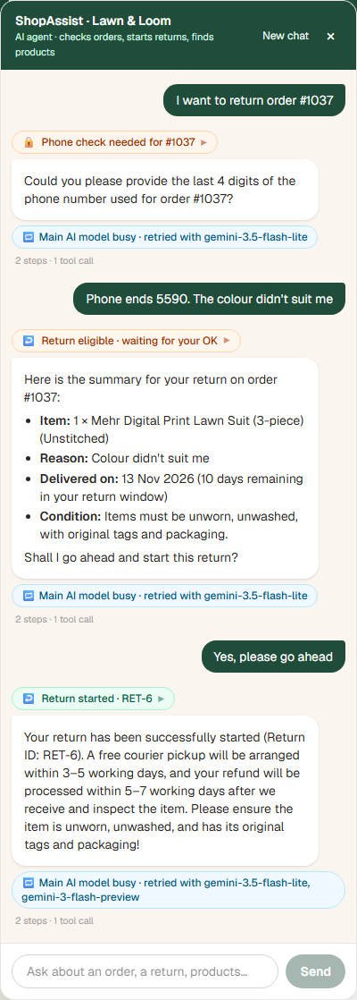
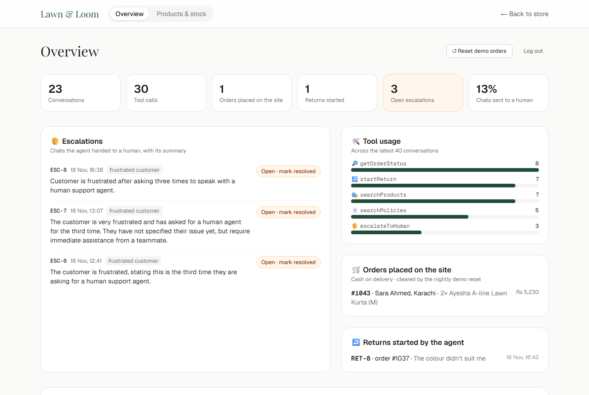
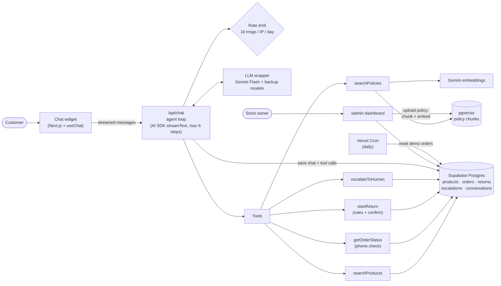

# ShopAssist: an AI support agent that answers *and acts* for an online store

**ShopAssist checks orders, starts returns, finds products and hands angry customers to a human. It shows every step it takes on screen.**

**▶ Live demo: https://shopassist-one.vercel.app** · click **“Try the AI support agent”**, no sign-up or data needed.

| The agent handling a return, step by step | Owner dashboard |
| --- | --- |
|  |  |

> 🎬 _Demo GIF placeholder: a 30-second screen recording of the five demo prompts will go here._

---

## The problem

Online stores in Pakistan answer the same questions all day: *“Where is my order?”*, *“Can I return this?”*, *“Do you have it under Rs 5,000?”*
Most chatbots can only paste FAQ text, so a person still has to look up the order, check the return rules and process the request.
That is slow for customers and expensive for the store.

## What the agent does

For every customer message, ShopAssist runs a small **agent loop** (up to 6 steps). It decides which tool it needs, calls it, reads the result, and repeats until it can answer.

1. **Answers policy questions from the store's own documents** (RAG over shipping, returns, sizing, FAQ and contact docs) and cites the source. If the docs don't cover it, it says so and offers a human. It never makes up a policy.
2. **Checks order status**, but only after verifying the **last 4 digits of the customer's phone**. Three wrong tries lock the order for that chat.
3. **Starts a return** after checking the rules in code (order delivered, within 14 days, not already returned). It **asks the customer to confirm before acting**.
4. **Finds products** by keyword, price and size.
5. **Hands over to a human** when the customer is upset, asks for a person, or the agent is unsure. It saves a ticket with a short summary for the team.
6. **Shows its work**: each tool call appears in the chat as a chip (🔎 *Checked order #1042*, ↩️ *Return started*, 🧑 *Sent to a human*). Click a chip to see the exact input and output. Model fallbacks (🔁) are shown too.

Visitors can also **order any product** from the store page (click a product → size, quantity, address → cash on delivery). The order is created in the database and priced on the server, and the confirmation offers **"Track it with ShopAssist"**, so the agent can immediately look up the order you just placed.

The store owner gets a password-protected **dashboard** at `/admin`. It shows stats, conversation replays with every tool call, escalations, orders placed on the site, and returns. The owner can upload a new policy document, which the agent can use immediately, and copy a **one-line `<script>` embed** for any website.

## Architecture



**Design choices in one line each**
- **The AI decides *what* to do; code decides *what is allowed*.** Phone checks, the 14-day window and confirm-before-acting are enforced inside the tools, not just requested in the prompt.
- **One LLM wrapper file** (`src/lib/llm.ts`): swapping Gemini for another provider means changing one file.
- **Resilience:** if the main Gemini model is busy (503/429) or slow, the agent switches to a backup model and tells the user. Database calls inside tools retry up to 3 times.
- **Everything is streamed**, so the customer watches the agent think and act in real time.

## Tech stack

| Layer | Choice |
| --- | --- |
| App | Next.js 16 (App Router) · TypeScript · Tailwind CSS 4 |
| Agent | Vercel AI SDK v7 (`streamText`, tools, UI message streaming) |
| LLM | Google Gemini Flash (free tier), with automatic fallback models |
| RAG | Gemini embeddings (`gemini-embedding-2`, 768 dims) · Supabase **pgvector** (HNSW, cosine) |
| Database | Supabase Postgres (orders, products, returns, escalations, conversations, rate limits) |
| Hosting | Vercel (free) + Supabase (free) · Vercel Cron for the daily demo reset |
| Testing | `scripts/test-agent.ts` (multi-turn agent scenarios) · Playwright UI checks |

## Run it locally (Windows)

You need **Node.js 22+**, **Git**, a free **Google AI Studio** API key and a free **Supabase** project.

```powershell
git clone https://github.com/Memoona-Amjad/shopassist.git
cd shopassist
npm install
copy .env.example .env
```

1. **Database:** in Supabase open **SQL Editor → New query**, paste the contents of `supabase/migrations/001_init.sql` and click **Run**.
2. **Keys:** fill in `.env`. Each value is explained in `.env.example`:
   - `SUPABASE_URL` and `SUPABASE_SECRET_KEY` (**Project Settings → API Keys**)
   - `GOOGLE_GENERATIVE_AI_API_KEY` (https://aistudio.google.com/apikey)
   - `LLM_MODEL=gemini-3.8-flash`
   - `LLM_FALLBACK_MODELS=gemini-3-flash-preview,gemini-3.5-flash-lite,gemini-3.1-flash-lite`
   - `EMBEDDING_MODEL=gemini-embedding-2` and `EMBEDDING_DIMENSIONS=768`
   - `ADMIN_PASSWORD`, `RATE_LIMIT_PER_DAY=10`, `APP_SECRET` and `CRON_SECRET` (any long random strings)
3. **Seed the demo store** (30 products, 40 orders, 5 policy docs, then chunks and embeddings):
   ```powershell
   npm run seed
   ```
4. **Start the app** and open http://localhost:3000. The owner dashboard is at http://localhost:3000/admin:
   ```powershell
   npm run dev
   ```

Useful scripts:

```powershell
npm run test:agent -- http://localhost:3000   # 8 multi-turn agent scenarios (all demo prompts + edge cases)
npm run seed -- --no-docs                     # reset demo orders without re-embedding the docs
npm run typecheck
npm run build
```

**Sample data for the demo:** order **#1042** (phone ends **4821**, shipped) · **#1037** (**5590**, delivered, returnable) · **#1029** (**1234**, too late to return) · **#1033** (**9876**, still processing).

## Project layout

```
src/app/page.tsx              Store page ("Lawn & Loom") + demo prompts
src/components/store/         Product grid, order form (cash on delivery)
src/app/api/orders/route.ts   Places a demo order (validated + priced on the server)
src/app/api/chat/route.ts     The agent loop (streaming, tools, rate limit, logging)
src/app/admin/                Owner dashboard (login, logs, escalations, uploads)
src/lib/agent/tools.ts        The 5 tools and the business rules they enforce
src/lib/agent/prompt.ts       The agent's instructions
src/lib/llm.ts                The only file that knows about Gemini (models, fallback, embeddings)
src/lib/rag.ts                Chunking, embedding and vector search for policy docs
src/components/chat/          Chat widget and tool-call chips
public/widget.js              One-line embed for other websites
supabase/migrations/          Database schema (tables, pgvector, search function)
data/policies/                The store's policy documents (markdown)
docs/HOW_IT_WORKS.md          Plain-English walkthrough + likely interview questions
```

## Limitations and next steps

**Honest limitations**
- **Demo data only.** Lawn & Loom is fictional, and orders, returns and escalations live in Supabase. A real store would connect to Shopify/WooCommerce and a courier API.
- **Phone-digit verification is light.** It suits a demo. Production would use an OTP sent to the customer's phone or a logged-in session.
- **Chat history is sent by the browser.** The server re-checks every rule (phone, 14 days, confirmation), but a determined user could edit their own history. Production would load the history from the database.
- **Free-tier AI.** Gemini's free models are sometimes overloaded. The agent falls back to backup models and says so, but answers can take 5–20 seconds at busy times.
- **Escalation stops at a ticket.** There is no live hand-off to an inbox like WhatsApp, email or a helpdesk yet.
- **Simple product search** (keyword scoring). Fine for 30 products. A large catalogue needs full-text or vector search.
- **Rate limit by IP** (10 messages/day) protects the free tier but can affect people sharing one office network.
- **Shared demo state.** If someone returns order #1037, it stays "already returned" for others until the nightly reset or the dashboard's **Reset demo orders** button.
- **Demo checkout only.** Orders are cash on delivery with no payment, stock count or real shipping. Orders placed on the site are deleted by the nightly reset, and each visitor can place 5 a day.

**Next steps**
1. Send escalations to WhatsApp, email or a helpdesk (e.g. Zendesk) and notify the team.
2. OTP verification and a real order system integration.
3. An evaluation suite run in CI (the scenario script already covers the demo flows).
4. Urdu / Roman-Urdu tuning and voice notes, which Pakistani customers use a lot.
5. Analytics: resolution rate without a human, and the most common questions to improve the policies.

---

Built by **Memoona Amjad** as an agentic-AI portfolio project. *Lawn & Loom is a made-up brand. Any resemblance to a real store is accidental.*
